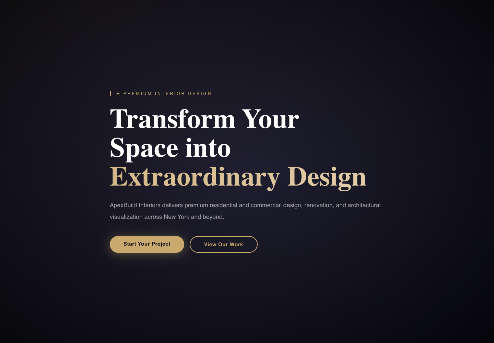

# ApexBuilds

### Interior design portfolio · Service discovery · Client workspace

ApexBuilds presents an interior design studio through a dark, gold-accented website backed by a Flask application. The experience connects a prominent project enquiry call to action with service pages, a project portfolio, and a dedicated customer workspace. It demonstrates how a service business can bring its public presence and day-to-day client information into one application.



*Genuine local browser capture of the hero section. All screenshots in this README were taken with external requests blocked; CDN-dependent styling, web fonts, and remote photographs were unavailable. See [capture notes](#screenshots-and-capture-notes) for the resulting limitations.*

## Experience and implemented features

- **A distinctive visual identity:** near-black and navy backgrounds, warm gold accents, serif headings, gradient text, rounded calls to action, and animated background glows defined in the project stylesheet.
- **A service business storefront:** home, about, services, portfolio and project detail pages, a blog, FAQs, and a contact enquiry form. The services page presents residential design, commercial design, renovation, remodeling, visualization, and space planning as service offerings.
- **Database-backed content:** active services, published projects, blog posts, and ordered FAQs are read through SQLAlchemy models. The contact handler stores enquiries as leads.
- **A customer workspace:** source includes authenticated project progress views, project messaging, consultation bookings, profile editing, documents, and invoice views with PDF downloads.
- **An administration area:** source includes role checks and interfaces for managing services, projects, leads, users, bookings, documents, blog posts, FAQs, and invoices.
- **Supporting integrations:** bcrypt password hashing, JWT email verification and reset links, Resend email code, and a Stripe PaymentIntent endpoint. Public discovery endpoints include `robots.txt` and a database-aware XML sitemap.

The public pages listed in the capture notes were checked in the browser. Authenticated workflows and integrations were inspected in source, without logging in, submitting forms, sending messages, or initiating payments. Visualization is a listed studio service; the application does not provide a 3D rendering tool.

## Technology

| Layer | Implementation |
| --- | --- |
| Application | Python, Flask 2.3.3, server-rendered Jinja templates |
| Data | Flask-SQLAlchemy 3.1.1; SQLite by default; configurable `DATABASE_URL` |
| Identity | Flask-Login, bcrypt, PyJWT |
| Interface | HTML, custom CSS, Tailwind via CDN, vanilla JavaScript |
| Typography | Playfair Display and Inter requested through Google Fonts |
| Documents and integrations | ReportLab PDFs, HTTPX/Resend email code, Stripe SDK |
| Server dependency | Gunicorn is declared in `requirements.txt` |

## Responsive design

Templates define desktop navigation, a mobile menu toggle, and responsive utility grids. Custom CSS scales the hero heading and buttons, adjusts section spacing, and changes dashboard layouts at smaller widths.

The homepage was tested on **20 October 2026** with the installed Chrome browser and Playwright, at a device scale factor of 1:

| Viewport | Homepage horizontal overflow | Browser JavaScript errors | Capture |
| --- | --- | --- | --- |
| 1440 × 1000 | None observed | None | [Full page](docs/screenshots/desktop-full.png) |
| 768 × 1024 | None observed | None | [Full page](docs/screenshots/tablet-full.png) |
| 390 × 844 | None observed | None | [Full page](docs/screenshots/mobile-full.png) |
| 320 × 844 | None observed | None | [Full page](docs/screenshots/mobile-320-full.png) |

These results cover the homepage under the capture restrictions. Blocking Tailwind leaves its responsive utilities unavailable: both navigation variants remain visible, and the menu button changes the `hidden` class without visibly collapsing the menu. A complete responsive navigation pass with its intended styles loaded remains unverified.

## Screenshots and capture notes

Screenshots come from the unchanged application using a temporary in-memory database populated by its existing seed function. The local `.env`, local database, customer records, and uploaded files were excluded. External page requests were blocked before navigation; service workers were disabled. No replacement styling, images, or interface elements were injected.

Tailwind, Google Fonts, and Unsplash requests were blocked. Consequently, the captures show fallback fonts, incomplete utility styling, and missing portfolio images. They document the restricted rendering faithfully rather than representing a fully styled hosted demo. Hero images are browser captures of the actual hero element; full-page images retain the navigation and footer.

| View | Desktop | Tablet | Mobile 390px | Mobile 320px |
| --- | --- | --- | --- | --- |
| Hero section | [1440px](docs/screenshots/desktop-hero.png) | [768px](docs/screenshots/tablet-hero.png) | [390px](docs/screenshots/mobile-hero.png) | [320px](docs/screenshots/mobile-320-hero.png) |
| Full homepage | [1440px](docs/screenshots/desktop-full.png) | [768px](docs/screenshots/tablet-full.png) | [390px](docs/screenshots/mobile-full.png) | [320px](docs/screenshots/mobile-320-full.png) |
| After menu toggle | — | — | [390px](docs/screenshots/mobile-navigation.png) | [320px](docs/screenshots/mobile-320-navigation.png) |
| Services page | [Desktop](docs/screenshots/desktop-services.png) | — | [Mobile](docs/screenshots/mobile-services.png) | — |
| Homepage service section | [Desktop](docs/screenshots/desktop-home-services.png) | — | — | — |
| Project listing | [Desktop](docs/screenshots/desktop-projects.png) | — | — | — |


Additional public route checks returned HTTP 200 for `/projects`, `/projects/modern-manhattan`, `/blog`, `/faq`, `/robots.txt`, and `/sitemap.xml`. The sample FAQ page has an empty state until content is added. All 14 screenshot files are losslessly optimized PNGs.

## Project structure

```text
ApexBuilds/
├── app.py                         # Flask app, models, routes, integrations and seed data
├── app/services/email_service.py   # Additional email service module
├── requirements.txt               # Pinned Python dependencies
├── templates/
│   ├── base.html                  # Shared navigation, footer and mobile menu script
│   ├── index.html                 # Homepage
│   ├── services.html              # Service offerings
│   ├── projects.html              # Portfolio listing
│   ├── dashboard.html             # Customer workspace
│   └── ...                        # Content, account, admin and invoice templates
├── static/css/style.css           # Theme, components, animation and media queries
├── docs/screenshots/              # Real browser captures
└── .gitignore                     # Excludes secrets, databases, caches and local files
```

## Run locally

Use Python 3, pip, and a virtual environment. The capture run used the existing Python 3.14.7 environment; a clean dependency installation was not performed during the documentation audit.

```bash
git clone https://github.com/sahilbhardwaj037037-sys/ApexBuilds.git
cd ApexBuilds
python3 -m venv venv
source venv/bin/activate
python -m pip install -r requirements.txt

# Local session configuration; use a fresh development database.
export SECRET_KEY="$(python -c 'import secrets; print(secrets.token_hex(32))')"
export DATABASE_URL='sqlite:///apex_xbuild.db'
export FRONTEND_URL='http://127.0.0.1:5000'
export RESEND_API_KEY=''
export STRIPE_SECRET_KEY=''

flask --app app run --host 127.0.0.1 --port 5000
```

Open [localhost:5000](http://127.0.0.1:5000). Browse `/services`, `/projects`, `/blog`, and `/faq` through the site navigation. The homepage's project enquiry and portfolio calls to action link to `/contact` and `/projects`.

Importing `app` creates tables and seeds sample services, projects, accounts, and a blog post. SQLite's relative database path resolves under Flask's `instance/` directory. The Flask CLI loads the entire module, including the quote routes defined after the direct-run block. Stop the development server with `Ctrl+C`.

The application also reads `.env` through python-dotenv. Environment variables set in the shell take precedence. For an existing checkout, review your local configuration before starting; do not commit `.env` or databases. The empty integration keys above keep email in mock mode and leave Stripe unconfigured. Optional integration settings are `RESEND_API_KEY`, `EMAIL_FROM`, `FRONTEND_URL`, and `STRIPE_SECRET_KEY`; no external integration is required to browse the public pages.

## Demo and deployment scope

Seeded project names, studio copy, team profiles, and experience figures are demonstration content, not independently verified client work or business results. The payment interface creates a PaymentIntent but does not implement card confirmation; it is not evidence of a completed payment. The quote submission handler also needs correction because it passes a field absent from the `Lead` model.

No hosted deployment URL or hosting configuration was verified in this repository. `app:app` is the WSGI entry point and Gunicorn is listed as a dependency. Before any public deployment, address the fixed-password seeded accounts and development secret fallback, and review authentication, request protection, uploads, and payment handling. Startup logs expose seeded account credentials, and email code logs API key prefixes; do not publish those logs. Authenticated and external workflows require separate functional and security validation.

The repository contains no `LICENSE` file. Templates reference Unsplash photographs and Google Fonts; image rights and redistribution permissions have not been verified.
